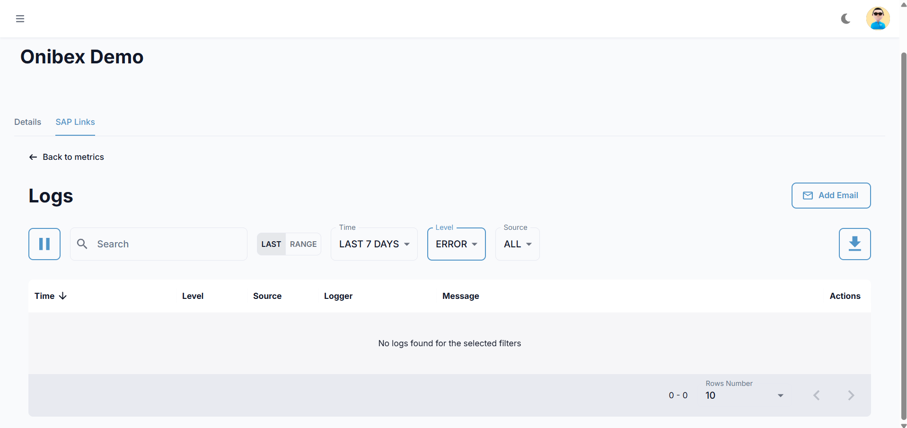
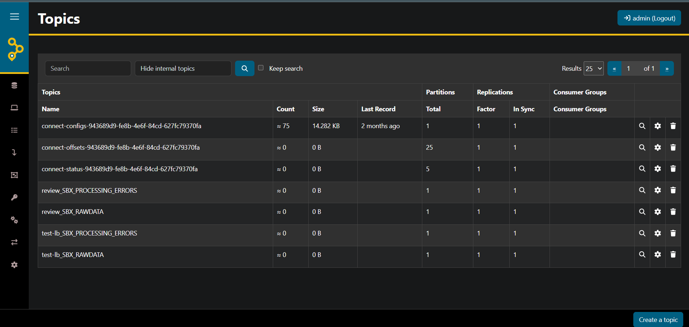

# Diagnostic Toolkit

This guide explains the places OneConnect surfaces errors, which log levels reach each of them, and how to get more detail when you need it.

The default log level covers the cases in this section. When you want more detail, you can optionally [raise the log level](#4-raising-the-log-level-to-see-more-detail).

---

## 1. The Logs Panel in the Web UI

The fastest first look. It aggregates logs from **Producer**, **Consumer**, and **SAP** for a given SAP Link.

Open your SAP Links dashboard and click **"Go to Logs"**. Filter by **Source** (`ALL` / `PRODUCER` / `CONSUMER` / `SAP`) and **Level** (`ALL` / `ERROR` / `WARN` / `FATAL`).



For the full reference on filters, the detail pop-up, Excel export, and email alerts, see [Working with Logs](../Smart_Gateway/Using_the_Smart_Gateway/07-Working_with_Logs.md).

### Which entries reach the panel

| Source | Levels shown | How entries arrive |
|---|---|---|
| `PRODUCER` / `CONSUMER` | `WARN`, `ERROR`, and `FATAL` | Sent in batches (about every 100 seconds, set by `TIME_BATCH`) |
| `SAP` | Every severity SAP reports, shown as `FATAL`, `ERROR`, `WARN`, `INFO`, `DEBUG`, or `TRACE` | Sent by the SAP OTel Bridge as each event arrives |

> 💡 The **Level** filter offers `WARN`, `ERROR`, `FATAL`, and `ALL`. SAP entries reported at `INFO`, `DEBUG`, or `TRACE` are visible when the Level filter is set to **`ALL`**.

> 📌 Producer and Consumer messages at `INFO` and `DEBUG` stay in the pod logs ([§2](#2-reading-logs-directly-from-kubernetes)). This keeps the panel focused on warnings and errors, even when you raise the pod log level to `DEBUG`.

> ℹ️ Each panel entry holds up to **10,000 characters**. As a guideline, read messages that embed a full record value (for example `Error Sending Record`) in the pod logs, which always carry the complete line.

Entries are kept for **32 days** by default; the retention period is set with `DAYS_CLEAN` (in days) on the Logs service.

### Counting occurrences

Entries are sent in batches (about every 100 seconds) and repeated messages are grouped; use the error-topic record count ([§5](#5-the-error-topics)) for exact totals.

---

## 2. Reading Logs Directly from Kubernetes

The complete view. Every line the pod writes at its current log level is here, with no grouping or delay.

### Find the pods

The Builder creates one Producer and one Consumer deployment per SAP Link, named `<workspace-id>-producer` and `<workspace-id>-consumer` and labeled `app=producer` / `app=consumer`:

```bash
# All Producer and Consumer pods
kubectl get pods -n oneconnect -l 'app in (producer,consumer)'

# The pods of one SAP Link
kubectl get pods -n oneconnect | grep <workspace-id>
```

### Tail the logs

```bash
# Producer — follow live
kubectl logs -n oneconnect <producer-pod> -f

# Consumer — last 200 lines
kubectl logs -n oneconnect <consumer-pod> --tail=200

# Only errors
kubectl logs -n oneconnect <consumer-pod> --tail=500 | grep -Ei 'error|exception|fail'

# Logs from the previous container, after a crash/restart
kubectl logs -n oneconnect <producer-pod> --previous
```

### Platform services

```bash
kubectl logs -n oneconnect -l app=builder    --tail=100   # SAP Link / workload creation
kubectl logs -n oneconnect -l app=logs       --tail=100   # log ingestion service
kubectl logs -n oneconnect -l app=apigateway --tail=100   # routing / auth forwarding
kubectl logs -n oneconnect -l app=auth       --tail=100   # UI login, JWT

# SAP OTel Bridge (one per bridge, named sap-otel-bridge-<id>)
kubectl get pods -n oneconnect | grep sap-otel-bridge
```

### Producer and Consumer log lines

Each line has the form `<date> <time> [<thread>] <LEVEL> <logger> - <message>`. The lines you will use most often:

**Producer**

```
2026-10-16 10:15:02.481 [<thread>] ERROR <logger> - -->Error Sending Record to topic=732_DEV_RAWDATA, value={...}, errorType=TimeoutException, cause=..., stackTrace=...
```

| Message | Level | Meaning |
|---|---|---|
| Search for `Starting to process` | `DEBUG` | A request from SAP reached the Producer (optional detail, see [§4](#4-raising-the-log-level-to-see-more-detail)) |
| `-->Error Sending Record to topic=..., value=..., errorType=..., cause=..., stackTrace=...` | `ERROR` | The record could not be handed to Kafka |
| `-->ExecutionException =<message>` | `ERROR` | Synchronous endpoint: Kafka did not confirm the record |
| `-->MalformedJsonException =<message>` | `ERROR` | The payload is not valid JSON; it is written to the `*_INBOUND_ERRORS` topic ([§5](#5-the-error-topics)) |
| `-->Authentication error. Incorrect username and/or password.` | `ERROR` | Synchronous endpoint: SAP credentials do not match. See [03 — Authentication](./03-Authentication_and_Credentials.md#2-diagnosing-a-401-from-sap) |

**Consumer**

```
2026-10-16 10:15:04.107 [<thread>] ERROR <logger> - Error processing record, will send to error topic, errorType=NullPointerException, cause=..., stackTrace=...
```

| Message | Level | Meaning |
|---|---|---|
| `Error processing record, will send to error topic, errorType=..., cause=..., stackTrace=...` | `ERROR` | A record from the raw topic could not be converted; it is written to the `*_PROCESSING_ERRORS` topic |
| `-->Error Sending Record to topic=..., key=..., value=..., errorType=..., cause=..., stackTrace=...` | `ERROR` | A converted record could not be written to its per-table topic; it is written to the `*_PROCESSING_ERRORS` topic |
| `Unhandled exception in consumerFactory at partition:... offset:..., errorType=..., cause=..., stackTrace=...` | `ERROR` | The poll cycle stopped on an error; the record in progress is written to the `*_PROCESSING_ERRORS` topic |
| `-->Critical Error: Failed to send error message to topic=..., value=..., errorType=..., cause=..., stackTrace=...` | `ERROR` | The entry could not be written to the error topic; the `value=` field holds the full entry, including the record |

| Field | Use it for |
|---|---|
| `topic` | Which table/stage failed |
| `errorType` | The exception class — the fastest routing signal (see table below) |
| `cause` | The exception message |
| `stackTrace` | Limited to 2000 characters in the message. The pod log prints the full stack trace right after the line |

### Routing an `errorType` to the right guide

| `errorType` | Go to |
|---|---|
| `SaslAuthenticationException`, `SslAuthenticationException`, `SSLHandshakeException` | [04 — Kafka Connectivity](./04-Kafka_Connectivity.md) |
| `TimeoutException`, `UnknownHostException`, `DisconnectException` | [04 — Kafka Connectivity](./04-Kafka_Connectivity.md) |
| `TopicAuthorizationException`, `ClusterAuthorizationException` | [04 — Kafka Connectivity](./04-Kafka_Connectivity.md#6-acls-and-authorization) |
| `RecordTooLargeException` | [04 — Kafka Connectivity](./04-Kafka_Connectivity.md#5-message-size-limits) |
| `SerializationException`, `RestClientException`, `AvroRuntimeException`, `SchemaParseException` | [05 — Avro & Schema Registry](./05-Avro_Serialization_and_Schema_Registry.md) |
| `NullPointerException`, `ClassCastException`, `NumberFormatException` | [05 — Avro & Schema Registry](./05-Avro_Serialization_and_Schema_Registry.md#3-a-field-without-a-value-in-a-row) |
| `NoSuchElementException` | [05 — Avro & Schema Registry](./05-Avro_Serialization_and_Schema_Registry.md#4-nosuchelementexception--missing-table-metadata) |
| `JsonSyntaxException`, `MalformedJsonException` | [06 — No Data Reaching Destination](./06-No_Data_Reaching_Destination.md) |

---

## 3. The Logs Panel Is Empty

**Symptom** — The Logs panel shows no `PRODUCER` or `CONSUMER` entries for an SAP Link, while the pod logs contain `WARN` or `ERROR` lines.

**Cause** — The entries have not been sent yet (batch window), the pod has nothing at `WARN` or above to send, or the pod cannot deliver its batch to the Logs service.

**Confirm and fix** — Work through these in order. The first three account for most cases.

| # | Check | How to confirm | Fix |
|---|---|---|---|
| 1 | Has the batch window elapsed? | — | Wait `TIME_BATCH` seconds (100 by default) after the error occurs, then refresh the panel |
| 2 | Are there any `WARN`+ logs at all? | `kubectl logs -n oneconnect <pod> \| grep -E 'WARN\|ERROR\|FATAL'` | If the pod only logs `INFO`, there is nothing to send. Use the pod logs for the full view |
| 3 | Are the filters hiding the entries? | Set **Source** and **Level** to `ALL` and widen the time range | SAP entries at `INFO`/`DEBUG`/`TRACE` are shown with Level `ALL` ([§1](#which-entries-reach-the-panel)) |
| 4 | Is log shipping enabled? | `kubectl exec -n oneconnect <pod> -- env \| grep ONECONNECT_FLAG_LOGS` | The value must be exactly `ENABLE` (upper case). The Builder sets it for every SAP Link |
| 5 | Is the workspace ID correct? | `kubectl exec -n oneconnect <pod> -- env \| grep ONECONNECT_WORKSPACE_ID` | It must be the SAP Link's workspace ID; entries are filed under this ID |
| 6 | Can the pod reach the Logs service? | `kubectl logs -n oneconnect <pod> \| grep "ERROR sending logs"` | This line reports a delivery problem for that batch; the text after it gives the reason (see below) |
| 7 | Is the Logs service itself healthy? | `kubectl get pods -n oneconnect -l app=logs` | It should be `Running`. Check its logs for database errors with `kubectl logs -n oneconnect -l app=logs --tail=100` |

Reading `ERROR sending logs` (the Producer writes `ERROR sending logs: <reason>`, the Consumer `ERROR sending logs : <reason>`):

| Reason contains | Meaning | What to do |
|---|---|---|
| `I/O error on POST request for "<url>"` | The URL cannot be reached | Check `ONECONNECT_LOGS_URL_PRODUCER` / `ONECONNECT_LOGS_URL_CONSUMER` and that the `logs` pod is `Running` |
| `404` | The URL path does not match a Logs service endpoint | The path must end in `/logs/reporter/controller-logs/logs-producer` (Producer) or `/logs/reporter/controller-logs/logs-consumer` (Consumer) |
| `401` | The URL goes through the API Gateway and the token was not accepted | If log shipping goes through the API Gateway, `ONECONNECT_SOFTSECURITYTOKEN` must match the gateway's `AUTH_SOFTAUTHTOKEN` as configured at install. See [03 — Authentication](./03-Authentication_and_Credentials.md#6-internal-soft-security-token) |
| `500` | The Logs service received the batch but could not store it | Check the Logs service logs (`kubectl logs -n oneconnect -l app=logs`) for database errors |

> 💡 At each batch interval the pod also prints the messages it is sending on stdout (plain lines without the timestamp prefix). Seeing them confirms the batch fired; seeing no `ERROR sending logs` line right after confirms delivery.

### SAP entries are missing

**Symptom** — `PRODUCER` / `CONSUMER` entries appear, but no `SAP` entries.

**Confirm** — Read the SAP OTel Bridge logs:

```bash
kubectl logs -n oneconnect <sap-otel-bridge-pod> --tail=200 | grep -E 'Failed to export SAP event|skipping SAP log export'
```

**Fix**

1. `Failed to export SAP event <event-id> to oneconnect-logs: <reason>` — the bridge could not reach the Logs service. Check that the `logs` pod is `Running` and that `TELEMETRY_LOGS_ENDPOINT` on the bridge points to `http://logs.oneconnect.svc.cluster.local:7072/logs/reporter/controller-logs/logs-sap` (the Helm value `SAPOTELBRIDGE_LOGSURL`).
2. `telemetry.logs.enabled=true but no endpoint configured; skipping SAP log export` — set the Helm value `SAPOTELBRIDGE_LOGSURL` (shown above). The Builder applies it to bridges it creates from then on.
3. No lines at all — confirm SAP is sending events to the bridge endpoint. See [Generating the SAP OTel Bridge Endpoint](../Smart_Gateway/Using_the_Smart_Gateway/08-Generating_SAP_OTel_Bridge_Endpoint.md).

### Environment variables that control log shipping

The Producer and Consumer read these six environment variables for log shipping. The Builder sets all of them on every SAP Link:

| Variable | Purpose | Builder value |
|---|---|---|
| `ONECONNECT_FLAG_LOGS` | Master on/off | `ENABLE` (must be exactly this value) |
| `ONECONNECT_LOGS_URL_PRODUCER` | Producer → Logs service endpoint (Producer only) | `http://logs.oneconnect.svc.cluster.local:7072/logs/reporter/controller-logs/logs-producer` |
| `ONECONNECT_LOGS_URL_CONSUMER` | Consumer → Logs service endpoint (Consumer only) | `http://logs.oneconnect.svc.cluster.local:7072/logs/reporter/controller-logs/logs-consumer` |
| `ONECONNECT_WORKSPACE_ID` | Files each entry under its SAP Link | The SAP Link's workspace ID |
| `ONECONNECT_SOFTSECURITYTOKEN` | Bearer token sent with each batch; must match the API Gateway's `AUTH_SOFTAUTHTOKEN` when log shipping goes through the gateway | The platform soft token |
| `TIME_BATCH` | Batch interval in **seconds** (positive integer) | `100` |

> 📌 Configure log shipping through these environment variables.

---

## 4. Raising the Log Level to See More Detail

This step is optional. The default `INFO` level is enough for the cases in these guides; `DEBUG` adds step-by-step detail in the pod logs when you want to follow a request more closely. Useful `DEBUG` messages:

| Operation | Reported at | Message |
|---|---|---|
| Request received from SAP (Producer) | `DEBUG` | Search for `Starting to process` |
| Kafka **topic creation** | `DEBUG` | `-->Start to create topic=<topic>` |
| Record sent to Kafka (Producer) | `DEBUG` | `-->Sending Record to topic=...` |
| **Sink connector** auto-creation (on-premise deployments, Consumer) | `DEBUG` | `-->Start to create SinkConnector for table=<table>` / `-->Failed to create SinkConnector for table=<table> Error=<reason>` |

### How to enable DEBUG temporarily

Set the root level on the workload with `LOGGING_LEVEL_ROOT`:

```bash
kubectl set env deployment/<workspace-id>-producer -n oneconnect LOGGING_LEVEL_ROOT=DEBUG
kubectl set env deployment/<workspace-id>-consumer -n oneconnect LOGGING_LEVEL_ROOT=DEBUG
```

The deployment restarts its pod with the new level. Reproduce the problem and read the new pod's logs:

```bash
kubectl logs -n oneconnect <pod> -f | grep -Ei 'topic|error|exception'
```

> ⚠️ **Revert when you are done.** `DEBUG` logs every record's value, which is verbose and places business data in pod logs.

```bash
kubectl set env deployment/<deployment> -n oneconnect LOGGING_LEVEL_ROOT-
```

> 📌 Raising the level to `DEBUG` keeps the UI panel unchanged: the Producer and Consumer send only `WARN` and above to it. The extra detail appears in `kubectl logs` only.

---

## 5. The Error Topics

Records that cannot be processed are preserved in dedicated Kafka topics. These are the most useful diagnostic source, because each entry carries the payload that produced the error.

| Topic | Written by | Contains |
|---|---|---|
| `<CLIENT>_<ENV>_INBOUND_ERRORS` | Producer | Payloads from SAP that are not valid JSON, stored exactly as received |
| `<CLIENT>_<ENV>_PROCESSING_ERRORS` | Consumer | Records that could not be converted to Avro or written to their per-table topic |

`<CLIENT>` is the SAP Link's topic prefix and `<ENV>` its SAP environment — the same prefix as the raw topic `<CLIENT>_<ENV>_RAWDATA`. The Consumer applies this prefix when `sapproperties.useprefix` is `ENABLE` (the default); otherwise its topic is simply `PROCESSING_ERRORS`.

Each `*_PROCESSING_ERRORS` entry has the shape:

```
Failed to send message
Error: <exception message>
Data: <the original record>
```

### Inspecting them in AKHQ

AKHQ is the Kafka UI deployed alongside the Kafka platform. Get its address with:

```bash
kubectl get svc -n kafka | grep akhq
```

Open the external IP in a browser, then:

1. Go to **Topics** and locate the `*_ERRORS` topic.
2. The topic list shows the **record count**, which is how many records have failed in total.
3. Open the **Data** tab to read the entries. `*_PROCESSING_ERRORS` entries show the `Error:` line and the `Data:` payload together; `*_INBOUND_ERRORS` entries show the payload as SAP sent it.
4. The payload is the exact data to replay once the root cause is resolved.



> 💡 The record count in these topics is the authoritative figure for how many records failed, since repeated identical messages are grouped in the UI panel ([§1](#counting-occurrences)).

---

## 6. A Five-Minute Health Check

Run this sequence before deep-diving. It localizes the fault to a single layer.

```bash
# 1. Is every platform pod up?
kubectl get pods -n oneconnect
kubectl get pods -n kafka

# 2. Does the Producer answer? (expects HTTP 200; this GET needs no credentials)
kubectl exec -n oneconnect <producer-pod> -- \
  curl -s -o /dev/null -w "%{http_code}\n" \
  http://localhost:8080/api/v1/saplistener/<workspace-id>

# 3. Is the Kafka cluster itself healthy?
kubectl get kafka -n kafka
kubectl get pods -n kafka

# 4. Get the AKHQ address for the remaining checks
kubectl get svc -n kafka | grep akhq
```

Then, in AKHQ:

| # | Check | Where in AKHQ |
|---|---|---|
| 5 | Do the topics exist, and is the raw topic `<CLIENT>_<ENV>_RAWDATA` growing? | **Topics** — the list shows every topic with its record count |
| 6 | Is the Consumer keeping up? | **Consumer Groups** → `<CLIENT>_<ENV>` (the Builder names each Consumer's group after its topic prefix and environment) — `LAG` should be near zero |
| 7 | Is anything landing in the error topics? | **Topics** → `*_ERRORS` — check the record count |

Interpreting the result:

| Result | Fault is in | Guide |
|---|---|---|
| Pods not `Running` | Deployment | [02](./02-Deployment_and_Installation.md) |
| Step 2 does not return `200` | Producer pod / networking | [02](./02-Deployment_and_Installation.md), [06](./06-No_Data_Reaching_Destination.md#3-sap-is-not-reaching-the-producer) |
| Raw topic missing or not growing | SAP → Producer → Kafka | [03](./03-Authentication_and_Credentials.md), [04](./04-Kafka_Connectivity.md) |
| Raw topic grows, per-table topics do not | Consumer / Avro | [05](./05-Avro_Serialization_and_Schema_Registry.md) |
| Consumer lag climbing steadily | Consumer throughput or crash loop | [06](./06-No_Data_Reaching_Destination.md) |
| Per-table topics grow, destination empty | Kafka Connect / sink | [06](./06-No_Data_Reaching_Destination.md) |
| `*_INBOUND_ERRORS` growing | SAP payload format | [06](./06-No_Data_Reaching_Destination.md) |
| `*_PROCESSING_ERRORS` growing | Avro / data quality | [05](./05-Avro_Serialization_and_Schema_Registry.md) |

---

## Summary

1. Start with the **UI Logs panel**: it carries Producer and Consumer `WARN` and above (sent in batches about every 100 seconds) and SAP events of every severity (set Level to `ALL` to see SAP `INFO`/`DEBUG`).
2. Use **`kubectl logs`** for the complete view, and route by `errorType`.
3. If the panel is empty, check the batch window, the filters, and the pod's stdout for `ERROR sending logs`.
4. Optionally **raise the log level** with `LOGGING_LEVEL_ROOT=DEBUG` for extra detail on requests, topic creation, and connector creation — and revert it afterwards.
5. Read the **error topics** (`*_INBOUND_ERRORS`, `*_PROCESSING_ERRORS`) to get the failing payload alongside the error.
6. Run the **five-minute health check** to localize the issue before opening a specific guide.
